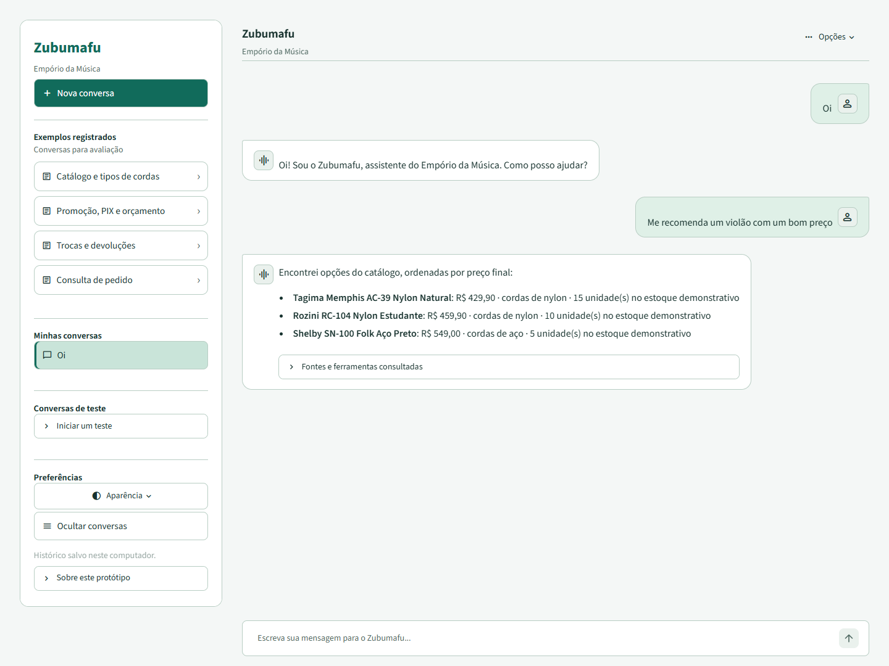
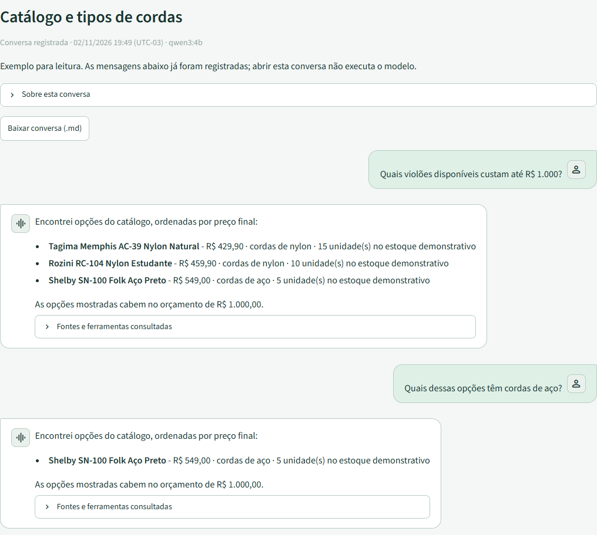
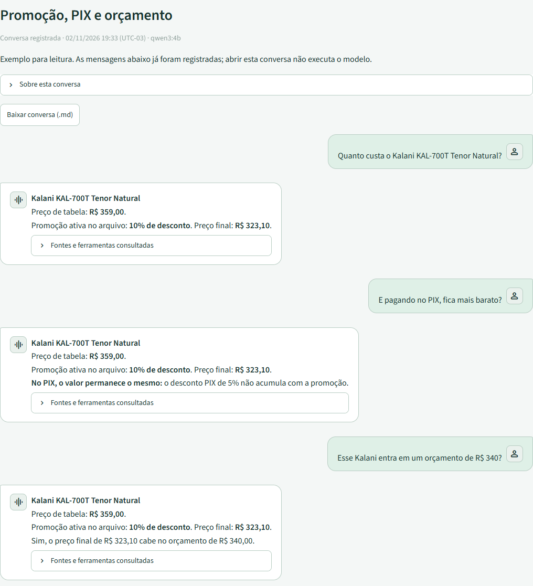
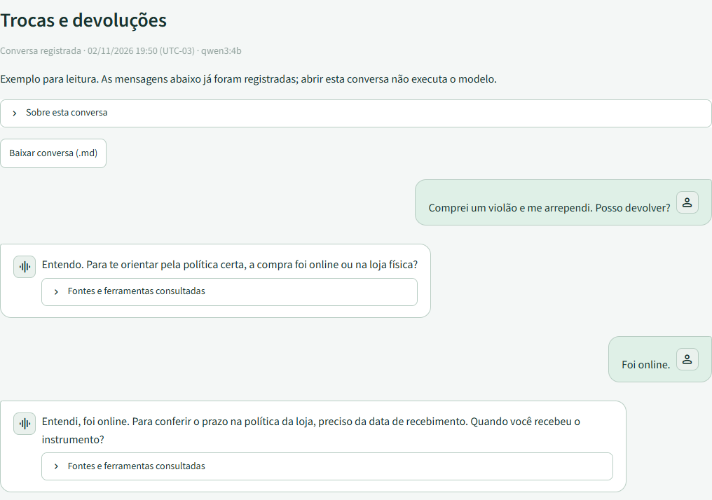
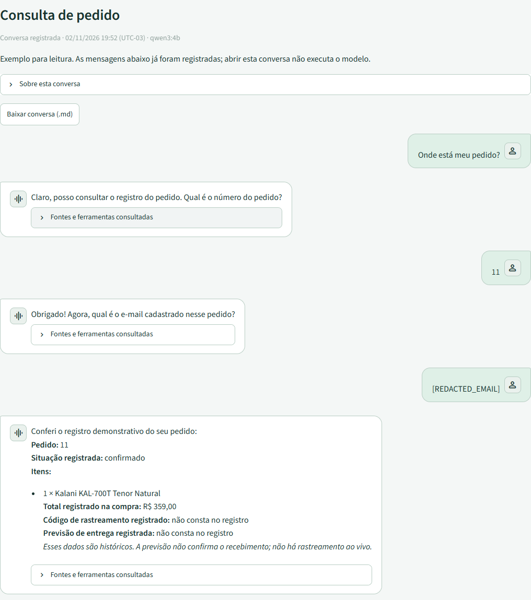
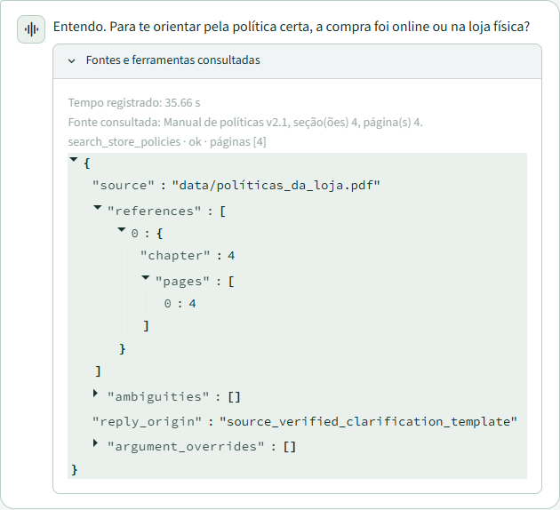
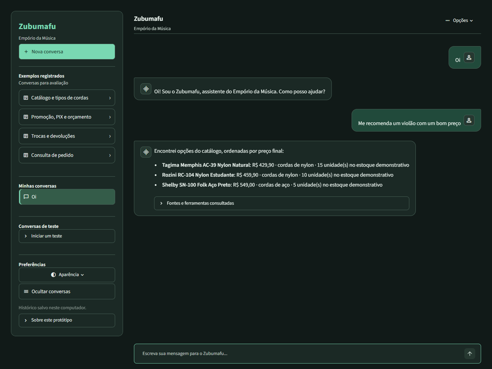
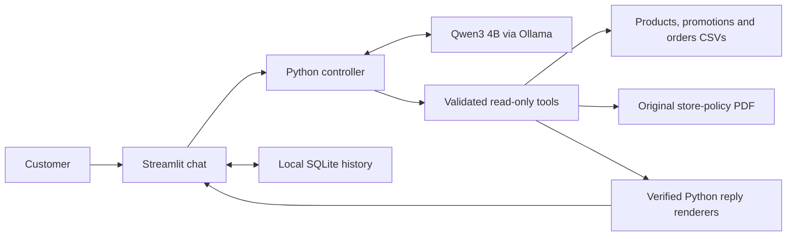

# Zubumafu

**A local AI assistant for a music store, with answers grounded in its catalog and policies.**

Built for Artefact's AI Engineer challenge. Zubumafu helps customers explore instruments, compare prices, understand return policies and check demonstration orders through a conversational interface.

**Python 3.12 · Streamlit · Qwen3 4B / Ollama · SQLite · 144 automated tests**

[Product tour](#product-tour) · [Architecture](#architecture) · [Run locally](#run-locally) · [Validation](#validation) · [Limitations](#limitations)

<picture>
  <source media="(prefers-color-scheme: dark)" srcset="docs/assets/screenshots/overview-dark.png">
  
</picture>

*Actual interface capture. This overview shows a fresh greeting and direct CSV recommendation, without LLM inference. The product tour below displays recordings of earlier real-model executions in the current UI. Conversations are in Brazilian Portuguese; documentation and translated transcripts are in English.*

## Review in a few minutes

| What to inspect | Where to look |
| --- | --- |
| Customer experience | Screenshots in the product tour below |
| Working conversations without running a model | Four read-only examples in the navigation panel |
| Original questions, answers and English translations | [Recorded interaction files](examples/) |
| Actual tool use, checks and timings | [Validation log](docs/validation.md) and [source reports](docs/evidence/) |
| Architecture and tradeoffs | [Decision record](docs/decisions.md) |
| Setup, configuration and implementation details | [Technical runbook](docs/runbook.md) |

The repository is a functional local challenge prototype. Its supplied data is a static demonstration snapshot, not live store inventory or carrier tracking.

## Product tour

### 1. Find instruments within a budget

Search available instruments by category and compare the **final eligible price** with the customer's budget. Each result keeps its own source specifications, including nylon or steel strings. Follow-up questions can refine the options already shown.



*Recorded acceptance conversation. The first turn used the actual model/tool cycle; the steel-string follow-up re-queried the real CSV directly through Python. [Source evidence](docs/evidence/quality_ui_acceptance.json).*

### 2. Explain promotions and PIX without inventing arithmetic

Prices are calculated with Python `Decimal`. The example preserves the original **R$ 359.00** price, applies the recorded **10% promotion** and returns **R$ 323.10**. PIX does not stack another discount on top of an active promotion. The final price fits a **R$ 340** budget.



*All three recorded turns used actual model/tool cycles. Python rendered the verified price fields and comparison. [Source evidence](docs/evidence/pricing_after_quality.json).*

### 3. Consult the original policy manual

The assistant retrieves the relevant PDF sections before answering. In a regret/return conversation, it asks about the purchase channel and actual receipt date before deciding what guidance is possible. It does not approve a return on incomplete information.



*Both recorded turns retrieved the supplied manual. Python enforced the source-backed clarification questions. [Source evidence](docs/evidence/policies_after_quality.json).*

### 4. Check an order while preserving its historical total

The demonstration asks for the order number, then the registered email. Python checks the order/customer association before revealing permitted fields. Current promotions never overwrite the historical total; absent tracking and delivery estimates remain absent.



*This is demonstration verification, not production authentication. The recorded email is redacted. Separate tests check wrong-email and nonexistent-order denials. [Source evidence](docs/evidence/orders_after_quality.json).*

### 5. Inspect the evidence behind an answer

Customer replies stay focused on the question. **Fontes e ferramentas consultadas** holds source files, PDF section/page references, lookup filters and reply provenance. Recorded timings and technical notes live in the same expandable area.



*Actual source panel from the recorded return-policy example. References come from the tool result rather than an invented model citation.*

<details>
<summary><strong>View the complete interface in both themes</strong></summary>

**Light**


**Dark**



</details>

Screenshots are unedited captures of the running application. [Capture provenance and file hashes](docs/assets/screenshots/manifest.json) distinguish fresh direct lookups from replayed real-run evidence. [Capture instructions](docs/screenshots.md) explain how to reproduce them with a disposable history.

## Architecture



The model handles tool selection and language within a bounded loop. Tool results return to the model, while Python controls factual catalog, pricing and order replies. Explicit return clarifications are also source-backed templates. Narrow greetings, category recommendations and string-type follow-ups can use direct controller paths; their traces identify that origin instead of claiming model tool use.

| Tool | Responsibility | Source |
| --- | --- | --- |
| `search_products` | Category, availability and final-price budget filtering | Products, categories and promotions CSVs |
| `get_product_pricing` | Promotion lookup, rounding and non-cumulative PIX calculation | Products/promotions CSVs and the documented payment rule |
| `search_store_policies` | Section retrieval, page references and ambiguity warnings | Original policy PDF |
| `get_order_status` | Demo credential matching and historical order fields | Orders, customers, order items and products CSVs |

**Why this approach:** plain Python keeps commercial rules explicit and testable. Section-based PDF retrieval is sufficient for the supplied eight-page manual, so the prototype does not need a vector database. Ollama enables local inference without an API key. Streamlit keeps the interface and backend in one small Python application. [Detailed reasoning and tradeoffs](docs/decisions.md).

## Run locally

Prerequisites: **Python 3.12**, Git and an installed, running **Ollama** application. The tested configuration uses Python 3.12.10, Ollama 0.40.13, SDK 0.6.3, Streamlit 1.66.1 and pypdf 6.21.4. Python dependency versions are pinned.

From PowerShell, run one command at a time:

```powershell
git clone https://github.com/Mathsto19/artefact-ai-engineer-challenge.git
cd artefact-ai-engineer-challenge
py -3.12 -m venv .venv
.\.venv\Scripts\python.exe -m pip install -r requirements.txt
ollama pull qwen3:4b
.\.venv\Scripts\python.exe -m streamlit run app.py
```

Open **http://localhost:8501**. Read-only recorded examples work without an Ollama server; new model-dependent conversations require it.

- **Nova conversa:** start an independent thread. Customer messages appear on the right, assistant replies on the left.
- **Exemplos registrados:** inspect four accepted recordings without inference or private-history imports.
- **Conversas de teste:** run seven prompt/criteria scenarios yourself; they start empty and are not automatically marked as passed.
- **Preferências > Aparência:** choose system, light or dark mode. The URL retains the selected theme.
- **Ocultar conversas / Abrir conversas:** collapse and restore navigation.
- **Opções > Excluir conversa:** delete only the selected thread after confirmation.

Try: `Quais violões disponíveis custam até R$ 1.000?`, `Quanto custa o Kalani KAL-700T Tenor Natural?`, or `Comprei um violão e me arrependi. Posso devolver?`.

For host/model/timeout options and troubleshooting, see the [technical runbook](docs/runbook.md).

## Validation

**144 automated tests passed in the latest full regression run.** They use real CSV/PDF files, simulated model responses where appropriate and Streamlit AppTest for interaction state. This count is separate from real-model acceptance and screenshot capture.

```powershell
.\.venv\Scripts\python.exe -m unittest discover -s tests -v
```

| Evidence | Coverage |
| --- | --- |
| Offline regression suite | Availability, budgets, Decimal pricing, policy references, order guards, tool failures, history and UI state |
| Real Ollama acceptance reports | Catalog, promotion/PIX, returns, order verification and quality scenarios |
| Direct controller evidence | Real CSV lookup without model inference, explicitly identified in traces |
| Browser captures | Selected current desktop states in light/dark mode; not a mobile-usability or full visual-regression guarantee |

Opt-in real-model checks are available as `scripts/check_catalog.py`, `check_policies.py`, `check_pricing.py`, `check_orders.py`, `check_quality.py` and `check_responsiveness.py`. They record source use and observed timing; structural checks still need answer review. [Commands and evidence](docs/runbook.md#offline-tests-and-real-model-check).

## Limitations

- **Latency:** local Qwen requests can take tens of seconds. One recorded recommendation run took 83.56 seconds. Direct lookups and early verified previews improve selected paths; they do not establish fast general inference. [Measured evidence](docs/evidence/recommendation_after_routing.json).
- **Bounded understanding:** catalog matching and dialogue/intent guards are purpose-built heuristics. Unfamiliar wording, ambiguous identities and long conversations can still fail. There is no universal grounding guarantee.
- **Static sources:** stock, prices and order status are supplied snapshots. There is no live inventory, carrier tracking, checkout, cancellation or refund integration.
- **Local demo privacy:** SQLite history is unencrypted and may contain entered emails. It is ignored by Git and intended for one trusted computer. Order-number/email matching is not production authentication.
- **Ambiguous policies:** conflicting contacts/installment rules and the exact R$ 500 delivery boundary are surfaced. Freight/installment calculations and return approvals are outside the implemented scope.
- **Reasoning controls:** the installed model template can generate reasoning despite `think=False`. The application buffers/filters it; it does not claim generation was disabled.

With more time, priorities would be broader grounded-dialogue evaluation, measured model/latency comparisons, better intent handling and production authentication/authorization before handling real customer records.

## AI assistance and development history

ChatGPT helped plan the architecture and draft the initial Python code, tests and feature increments. Codex integrated older snapshots into the canonical repository, refined source handling and safeguards, ran validation and improved the interface/documentation. Qwen3 4B is the local inference model used by the application. Python templates, direct lookups, simulated tests and real-model runs are identified separately in the evidence.

The commit history preserves real incremental development, including fixes motivated by failed model runs and interface feedback. Screenshots show the current UI; historical transcripts remain unchanged to preserve what was actually observed.

**Project references:** [official challenge](desafio_tecnico_ai_eng_artefact.pdf) · [architecture decisions](docs/decisions.md) · [technical runbook](docs/runbook.md) · [validation history](docs/validation.md) · [original data](data/)
